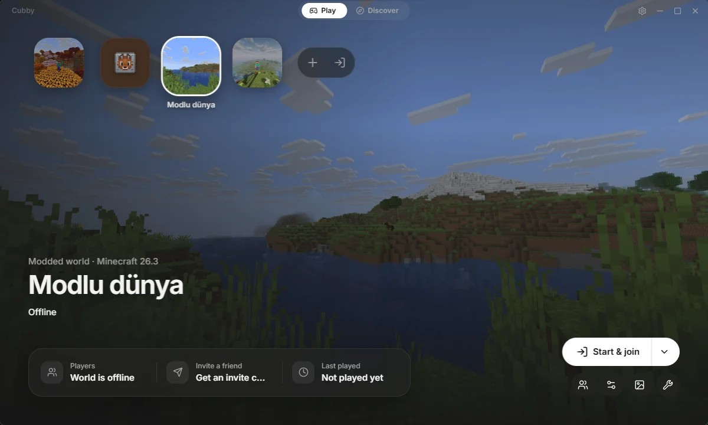
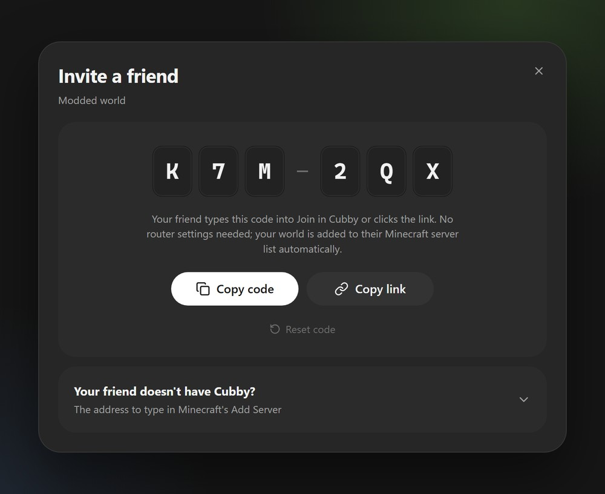
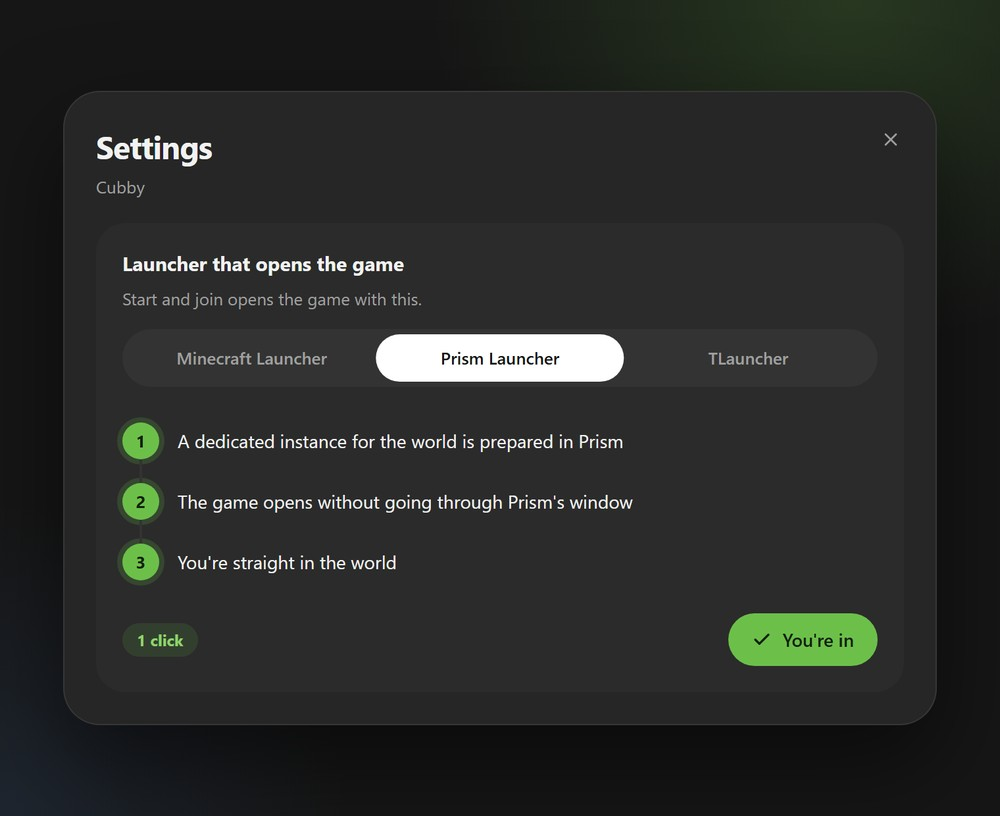
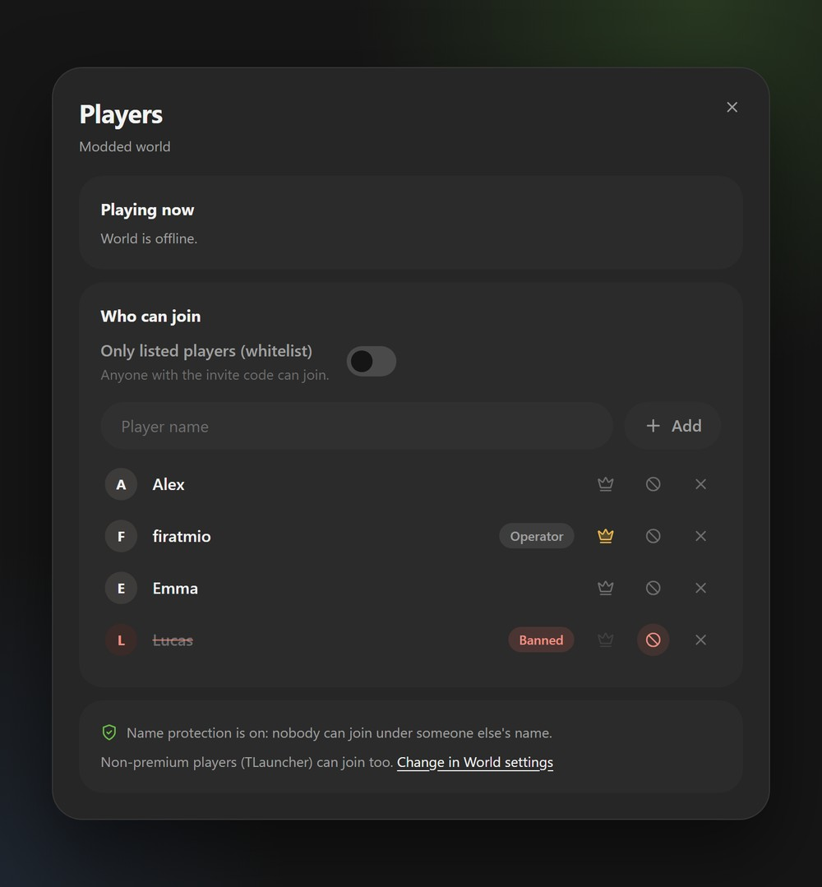
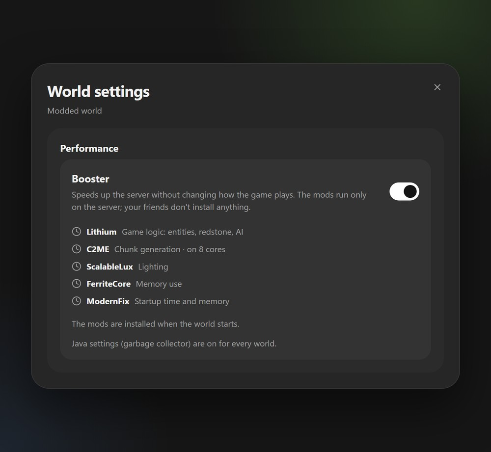
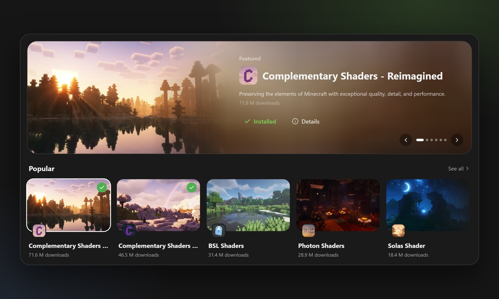
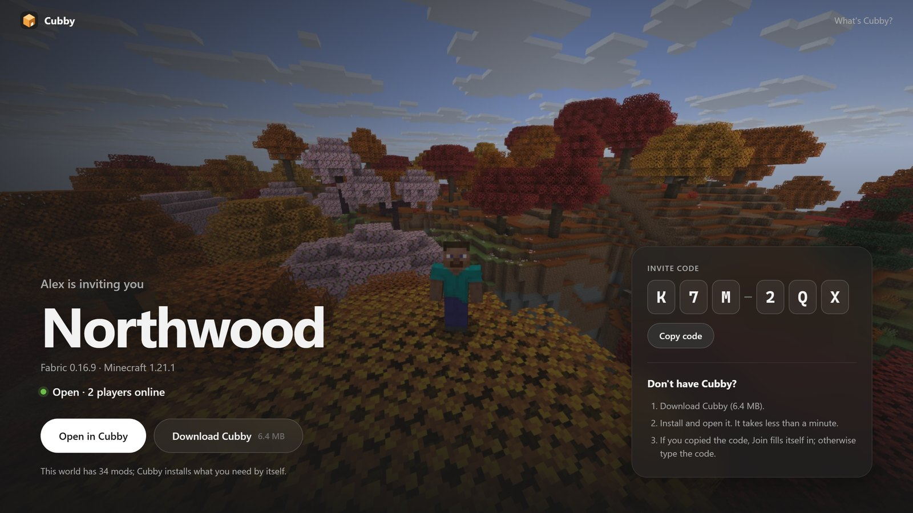
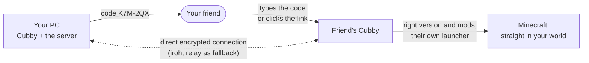

<div align="center">


# Cubby

**Your own Minecraft world, with your friends.**<br>
Cubby sets up the server, keeps it running and brings your friends in with a 6-character code.<br>
No port forwarding, no rented server, no terminal.

[](https://github.com/firatmio/cubby/releases)
[](https://github.com/firatmio/cubby/releases)
[](https://github.com/firatmio/cubby/actions/workflows/ci.yml)

[](LICENSE)

**[Download for Windows](https://cubby.quacomes.com/download)** · [Website](https://cubby.quacomes.com) · [Join with a code](https://cubby.quacomes.com/#join) · [Türkçe](README.tr.md)

<br>



</div>

## Why Cubby

Playing on your own world with friends usually means renting a server or fighting with router settings,
Java versions and mod lists. Cubby does all of that for you: pick a loader, press **Start and join**, send
the code. Your friend types it in (or just clicks the link) and lands in your world with the right
version and the right mods, whatever launcher they use.

## Features

<table>
<tr>
<td width="50%"></td>
<td>

### Send a code, they're in
A 6-character code (`K7M-2QX`) or its link. Cubby connects your friend's computer straight to yours,
even across cities and different internet providers. No port forwarding, nothing to configure.

- Link previews with your world's cover in WhatsApp and Discord
- Your world is added to their Minecraft server list automatically
- Renew the code and the old invite stops working

</td>
</tr>
<tr>
<td>

### Any launcher your friend uses
Cubby opens the game with the launcher your friend already has, and never touches their account.

- **Prism Launcher:** one click, straight into the world
- **TLauncher:** opens with the world's version selected
- **Minecraft Launcher:** a per-world profile, ready to play

</td>
<td width="50%"></td>
</tr>
<tr>
<td width="50%"></td>
<td>

### You choose who gets in
Whitelist, operators, kicking and banning on one screen. Non-premium (TLauncher) friends can join safely.

- **Name protection:** each name is tied to the computer that first joined with it
- **Bans stick:** a banned friend can't come back under a new name
- Allow someone who couldn't join with one click

</td>
</tr>
<tr>
<td>

### Smooth on a modest PC
The **Booster** speeds up the server without changing how the game plays, on vanilla worlds too.
Your friends install nothing.

- World pre-generation about 1.5× faster (measured)
- Lithium, C2ME, ScalableLux, FerriteCore, ModernFix, kept up to date
- Tells you when the server struggles, with a fix

</td>
<td width="50%"></td>
</tr>
</table>

### All of Modrinth, inside the app
Mods, modpacks, shaders, resource packs and data packs, matched to your world's version and installed
together with everything they need. A modpack becomes a new world in one click, and friends get the mods
they need on their own.



### An invite page your friends will actually open
The link opens on your world's cover and shows who's inviting, the version and whether the world is open
right now. Friends without Cubby get a three-step guide; the code is copied so Join fills itself in.



## How it works



- **The server runs on your computer.** Your world never leaves it; when your PC is off, the invite page
  says *Closed right now*.
- **Friends connect app to app** with [iroh](https://www.iroh.computer): a direct, encrypted connection that
  punches through NAT, with a relay only when that fails. You can also open a world to the internet (UPnP)
  or play on the same network without Cubby on the other side.
- **Everything else is automatic:** the right Java is downloaded when needed, loaders (Fabric, NeoForge,
  Forge, Quilt, Paper) are installed with verified hashes, and mods are synced to each friend.

## Install

1. [Download Cubby](https://cubby.quacomes.com/download) for Windows 10 or 11 (about 6 MB).
2. Windows may say "unknown publisher" because Cubby isn't code-signed yet: **More info › Run anyway**.
3. That's it. Cubby updates itself in the background; Settings › Updates has a preview channel.

You need Minecraft: Java Edition. Non-premium players (TLauncher) are supported.

## Privacy

Cubby has no accounts. To make invite codes work, the app sends our small invite server
([web/](web/)) only: the world's name, loader and version, your in-game name, the cover image, the
player count and the mod count. Never player names, never your world. A code works until you renew it
and is deleted after 60 days without use. Screenshots used as world covers stay on your computer.

## Development

Requirements: [bun](https://bun.sh), Rust (stable) and WebView2 on Windows. Java isn't needed: Cubby
downloads an Eclipse Temurin JRE when no suitable one is found.

```bash
bun install
bun run tauri dev
```

The UI also runs in a browser with mock data: `bun run dev` and open `http://localhost:1420`
(development only, see `src/lib/mock.ts`).

```bash
cd src-tauri && cargo test && cargo clippy --all-targets   # backend
bun run build                                              # UI type check and build
cd web && bun test && bun run typecheck                    # website and invite API
```

Live tests that reach Mojang, Fabric, Paper, NeoForge, Forge, Quilt and Adoptium:
`cargo test -- --ignored live_install`.

<details>
<summary><b>Project layout</b></summary>

```
src/          React UI: screens, app shell, translations (src/i18n)
src-tauri/    Rust backend: servers, Java, loaders, Modrinth, P2P (iroh), launcher bridges
web/          cubby.quacomes.com: the website, invite pages and the invite API (Vercel + Redis)
scripts/      release script (bun run release <version> [--beta])
docs/         milestones, design notes and the release guide
```

</details>

<details>
<summary><b>Translations</b></summary>

UI text lives in `src/i18n/tr.ts` (the source dictionary) and `src/i18n/en.ts`; a missing key in
`en.ts` fails `tsc`. Rust messages use `tx!("Türkçe", "English")` side by side (`src-tauri/src/i18n.rs`).

</details>

<details>
<summary><b>Where data is stored</b></summary>

Worlds live in `%APPDATA%\com.quacomes.cubby\instances\<id>\{instance.json, server/}` by default. A
different folder can be chosen in the setup wizard; `instances.json` records which world lives where.

</details>

## Roadmap

Everything built so far is in [docs/MILESTONES.md](docs/MILESTONES.md). Next up:

- Code signing, so Windows stops warning about an unknown publisher
- *Whoever is online keeps the world open*: a shared world for the whole friend group
- More launcher bridges

Found a bug or have an idea? [Open an issue](https://github.com/firatmio/cubby/issues/new/choose).

## License

Cubby is **source-available, not open source**. The code is public for reading; copying, modifying,
redistributing or reusing it elsewhere needs written permission. Using the official releases is free.
See [LICENSE](LICENSE) and, for third-party assets, [docs/ASSETS.md](docs/ASSETS.md).

<sub>NOT AN OFFICIAL MINECRAFT PRODUCT. NOT APPROVED BY OR ASSOCIATED WITH MOJANG OR MICROSOFT.</sub>
