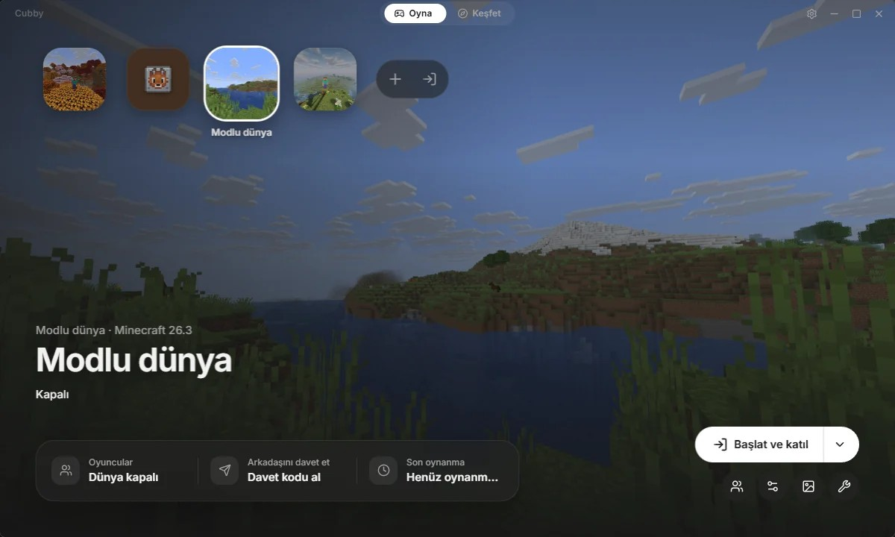
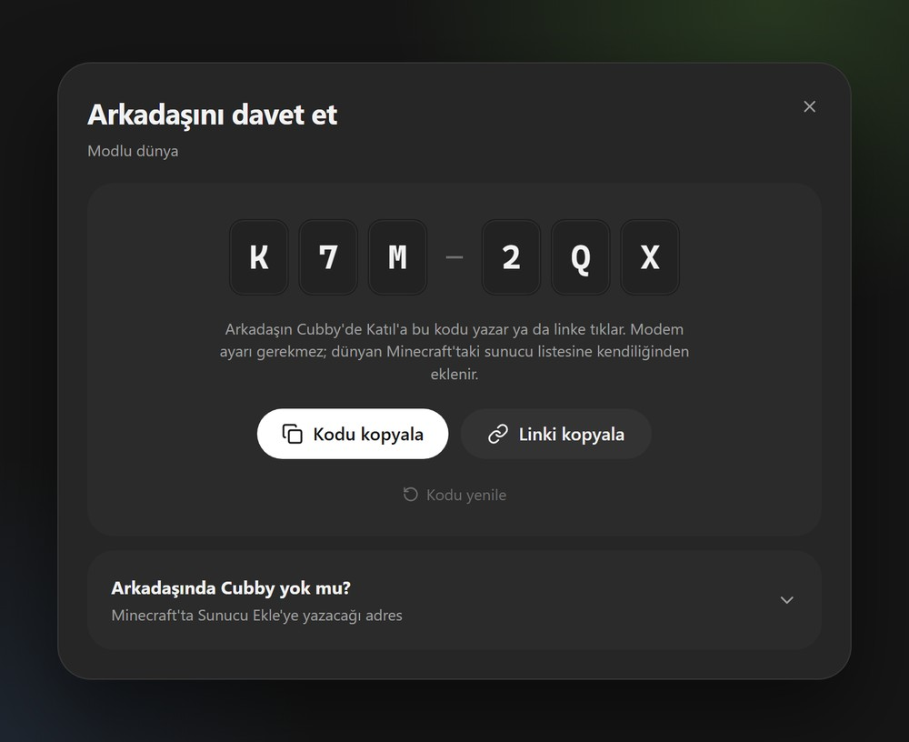
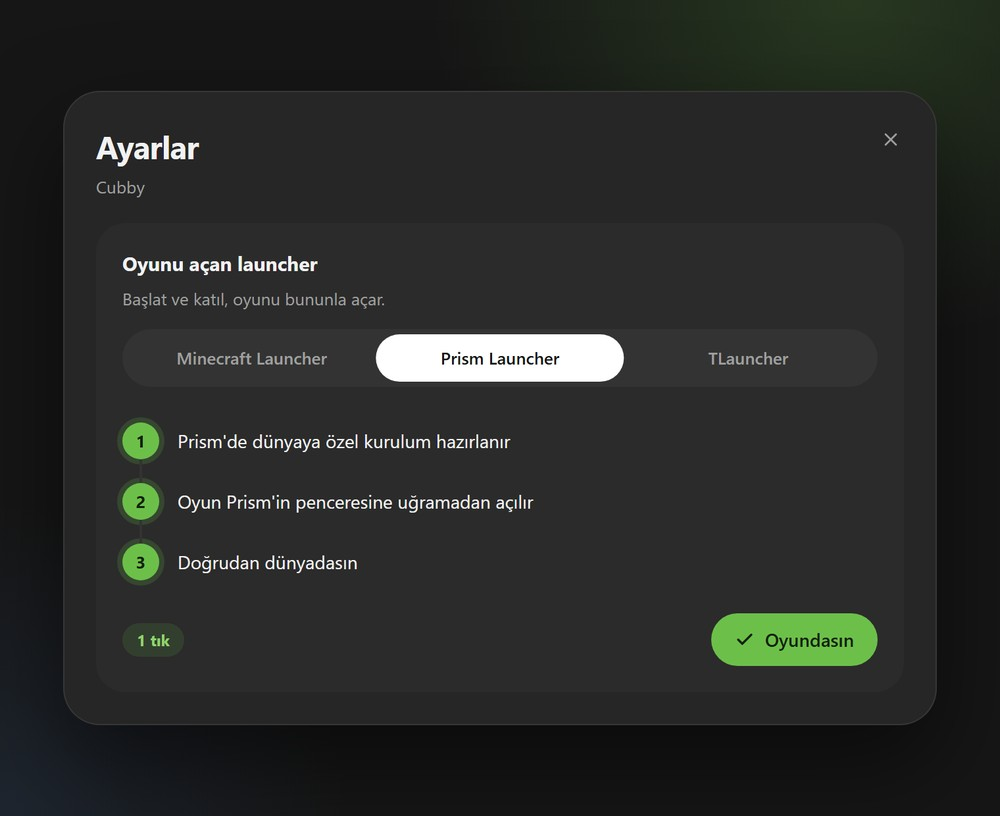
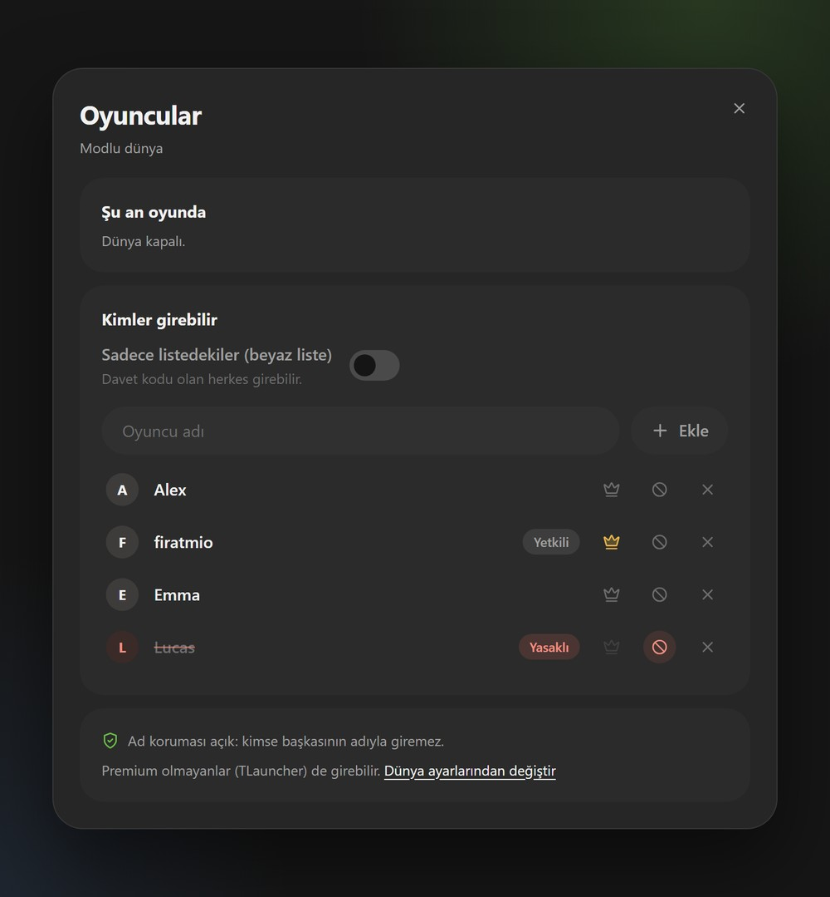
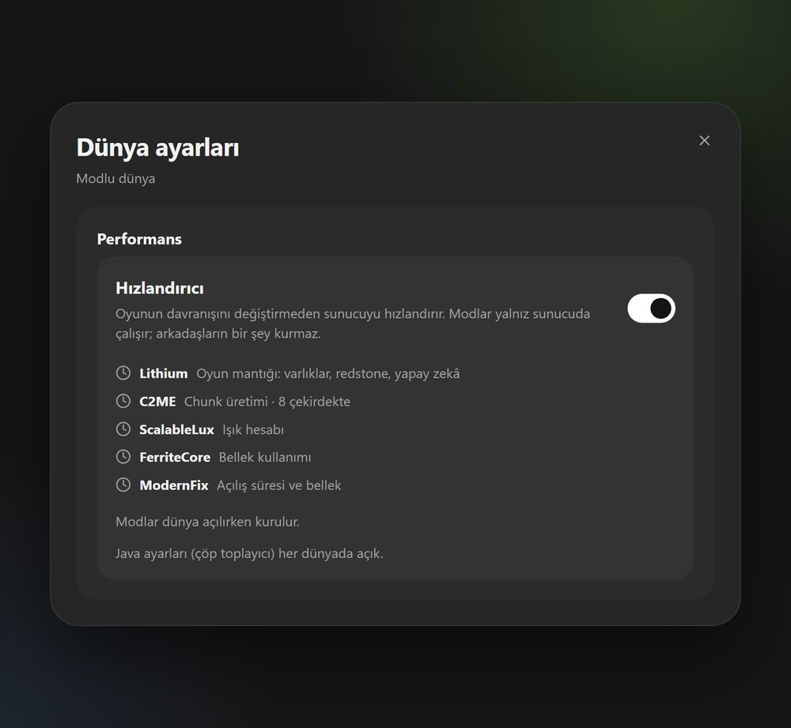
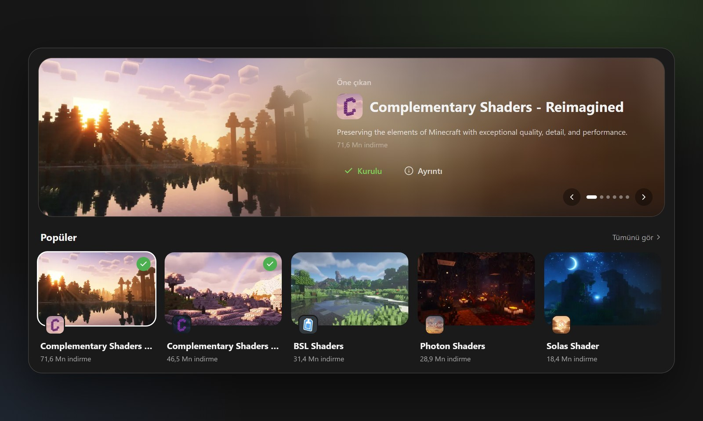
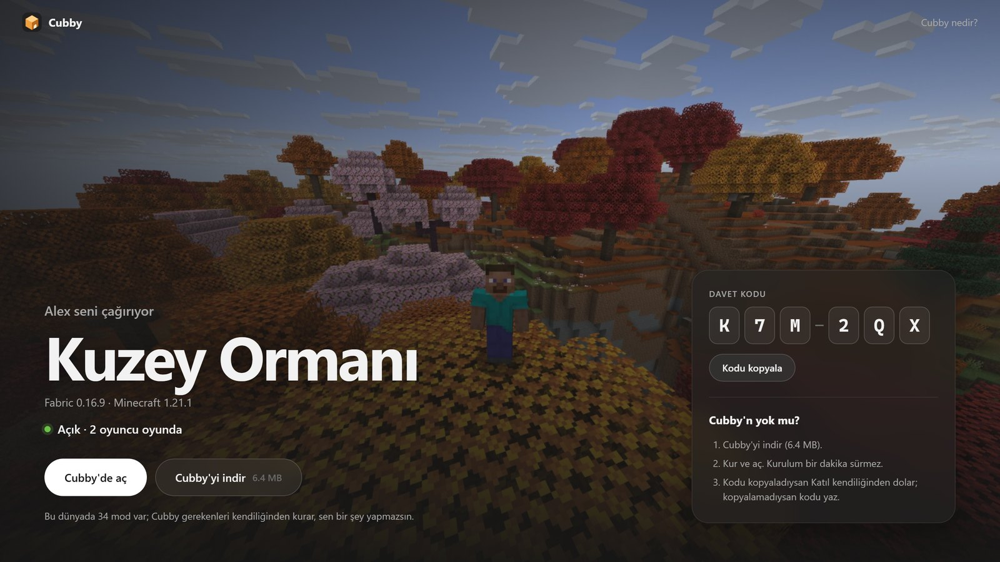
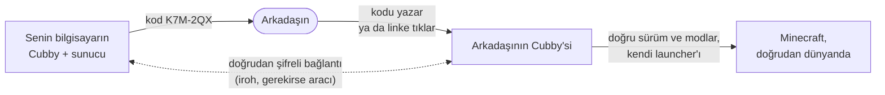

<div align="center">


# Cubby

**Arkadaşlarınla kendi Minecraft dünyan.**<br>
Cubby sunucuyu kurar, açık tutar ve arkadaşlarını 6 karakterlik bir kodla içeri alır.<br>
Modem ayarı yok, kiralık sunucu yok, terminal yok.

[](https://github.com/firatmio/cubby/releases)
[](https://github.com/firatmio/cubby/releases)

[](LICENSE)

**[Windows için indir](https://cubby.quacomes.com/download)** · [Site](https://cubby.quacomes.com) · [Kodla katıl](https://cubby.quacomes.com/#join) · [English](README.md)

<br>



</div>

## Neden Cubby

Arkadaşlarınla kendi dünyanda oynamak çoğu zaman sunucu kiralamak ya da modem ayarları, Java sürümleri ve
mod listeleriyle boğuşmak demek. Cubby bunların hepsini senin yerine yapar: altyapıyı seç, **Başlat ve
katıl**'a bas, kodu at. Arkadaşın kodu yazar (ya da linke tıklar) ve hangi launcher'ı kullanırsa kullansın
doğru sürümle, doğru modlarla dünyana girer.

## Özellikler

<table>
<tr>
<td width="50%"></td>
<td>

### Kodu at, gelsinler
6 karakterlik bir kod (`K7M-2QX`) ya da linki. Cubby arkadaşının bilgisayarını doğrudan seninkine bağlar;
farklı şehirde, farklı internette olsa da. Port açmak yok, ayar yok.

- WhatsApp ve Discord'da dünyanın kapağıyla önizleme
- Dünyan Minecraft'taki sunucu listesine kendiliğinden eklenir
- Kodu yenileyince eski davet geçersiz olur

</td>
</tr>
<tr>
<td>

### Arkadaşın hangi launcher'ı kullanırsa
Cubby oyunu arkadaşının zaten kullandığı launcher'la açar, hesabına dokunmaz.

- **Prism Launcher:** tek tık, doğrudan dünyada
- **TLauncher:** dünyanın sürümü seçili açılır
- **Minecraft Launcher:** her dünyaya özel profil, Oyna'ya hazır

</td>
<td width="50%"></td>
</tr>
<tr>
<td width="50%"></td>
<td>

### Kim girer, sen seçersin
Beyaz liste, yöneticiler, atma ve yasaklama tek ekranda. Premium olmayan (TLauncher) arkadaşlar da güvenle girer.

- **Ad koruması:** her ad, onunla ilk giren bilgisayara bağlanır
- **Yasak kalıcı:** yasaklanan, adını değiştirse de giremez
- Giremeyen arkadaşa tek tıkla izin

</td>
</tr>
<tr>
<td>

### Zayıf bilgisayarda da akıcı
**Hızlandırıcı**, oyunun davranışını değiştirmeden sunucuyu hızlandırır; saf dünyalarda da.
Arkadaşların hiçbir şey kurmaz.

- Dünya hazırlama yaklaşık 1,5 kat daha hızlı (ölçtük)
- Lithium, C2ME, ScalableLux, FerriteCore, ModernFix; güncel tutulur
- Sunucu zorlanırsa söyler ve çözüm önerir

</td>
<td width="50%"></td>
</tr>
</table>

### Modrinth'in tamamı uygulamanın içinde
Modlar, mod paketleri, shader'lar, kaynak paketleri ve veri paketleri; dünyanın sürümüne uyanı, gerektirdikleriyle
birlikte kurulur. Bir mod paketi tek tıkla yeni dünya olur, arkadaşların gereken modları kendiliğinden alır.



### Arkadaşının gerçekten açacağı bir davet sayfası
Link dünyanın kapağıyla açılır; kimin çağırdığı, sürüm ve dünyanın şu an açık olup olmadığı görünür.
Cubby'si olmayan arkadaş üç adımlık bir rehber görür; kod kopyalanır, Katıl kendiliğinden dolar.



## Nasıl çalışır



- **Sunucu senin bilgisayarında çalışır.** Dünyan oradan çıkmaz; bilgisayarın kapalıyken davet sayfası
  *Şu an kapalı* der.
- **Arkadaşlar uygulamadan uygulamaya bağlanır:** [iroh](https://www.iroh.computer) ile doğrudan ve şifreli;
  NAT'ı aşar, olmazsa aracı sunucudan geçer. İstersen dünyayı internete de açabilirsin (UPnP) ya da aynı
  evde karşı tarafta Cubby olmadan oynayabilirsin.
- **Gerisi kendiliğinden:** gerekirse doğru Java indirilir, altyapılar (Fabric, NeoForge, Forge, Quilt,
  Paper) doğrulanmış özetlerle kurulur, modlar her arkadaşa eşitlenir.

## Kurulum

1. Windows 10 ya da 11 için [Cubby'yi indir](https://cubby.quacomes.com/download) (yaklaşık 6 MB).
2. Cubby henüz kod imzası almadığı için Windows "bilinmeyen yayımcı" diyebilir: **Ek bilgi › Yine de çalıştır**.
3. Bu kadar. Cubby kendini arka planda günceller; Ayarlar › Güncellemeler'de deneme kanalı var.

Minecraft: Java Edition gerekir. Premium olmayan oyuncular (TLauncher) desteklenir.

## Gizlilik

Cubby'de hesap yok. Davet kodlarının çalışması için uygulama küçük davet sunucumuza ([web/](web/)) yalnız
şunları gönderir: dünyanın adı, altyapısı ve sürümü, oyundaki adın, kapak görseli, oyuncu sayısı ve mod
sayısı. Oyuncu adları ve dünyanın kendisi asla gönderilmez. Kod, sen yenileyene kadar çalışır; 60 gün
kullanılmazsa silinir. Dünya kapağı olarak kullanılan ekran görüntüleri bilgisayarından çıkmaz.

## Geliştirme

Gerekenler: [bun](https://bun.sh), Rust (stable) ve Windows'ta WebView2. Java gerekmez: uygun sürüm
bulunamazsa Cubby bir Eclipse Temurin JRE indirir.

```bash
bun install
bun run tauri dev
```

Arayüz sahte verilerle tarayıcıda da açılır: `bun run dev`, sonra `http://localhost:1420`
(yalnız geliştirmede, bkz. `src/lib/mock.ts`).

```bash
cd src-tauri && cargo test && cargo clippy --all-targets   # arka uç
bun run build                                              # arayüz tip denetimi ve derleme
cd web && bun test && bun run typecheck                    # site ve davet API'si
```

Mojang, Fabric, Paper, NeoForge, Forge, Quilt ve Adoptium'a giden canlı testler:
`cargo test -- --ignored live_install`.

<details>
<summary><b>Proje düzeni</b></summary>

```
src/          React arayüzü: ekranlar, uygulama kabuğu, çeviriler (src/i18n)
src-tauri/    Rust arka ucu: sunucular, Java, altyapılar, Modrinth, P2P (iroh), launcher köprüleri
web/          cubby.quacomes.com: site, davet sayfaları ve davet API'si (Vercel + Redis)
scripts/      yayın betiği (bun run release <sürüm> [--beta])
docs/         kilometre taşları, tasarım notları ve yayın rehberi
```

</details>

<details>
<summary><b>Çeviriler</b></summary>

Arayüz metinleri `src/i18n/tr.ts` (kaynak sözlük) ve `src/i18n/en.ts`'te; `en.ts`'te eksik anahtar `tsc`'yi
kırar. Rust mesajları `tx!("Türkçe", "English")` ile yan yana yazılır (`src-tauri/src/i18n.rs`).

</details>

<details>
<summary><b>Veriler nerede durur</b></summary>

Dünyalar varsayılan olarak `%APPDATA%\com.quacomes.cubby\instances\<id>\{instance.json, server/}` altında.
Kurulum sihirbazında başka bir klasör seçilebilir; hangi dünyanın nerede olduğu `instances.json`'da kayıtlı.

</details>

## Yol haritası

Şimdiye kadar yapılanların hepsi [docs/KILOMETRE_TASLARI.md](docs/KILOMETRE_TASLARI.md)'de. Sırada:

- Kod imzası: Windows "bilinmeyen yayımcı" uyarısını göstermesin
- *Kim açıksa dünya açık*: arkadaş grubunun ortak dünyası
- Daha fazla launcher köprüsü

Bir hata buldun ya da aklına bir fikir mi geldi? [Issue aç](https://github.com/firatmio/cubby/issues/new/choose).

## Lisans

Cubby **açık kaynak değil, kaynağı görünür**. Kod okumak için herkese açık; kopyalamak, değiştirmek, dağıtmak
ya da başka yerde kullanmak yazılı izin ister. Resmi sürümleri kullanmak ücretsiz.
Ayrıntılar [LICENSE](LICENSE)'ta, üçüncü taraf assetler [docs/ASSETS.md](docs/ASSETS.md)'de.

<sub>RESMİ BİR MINECRAFT ÜRÜNÜ DEĞİLDİR. MOJANG YA DA MICROSOFT TARAFINDAN ONAYLANMAMIŞTIR VE ONLARLA BAĞLANTILI DEĞİLDİR.</sub>
